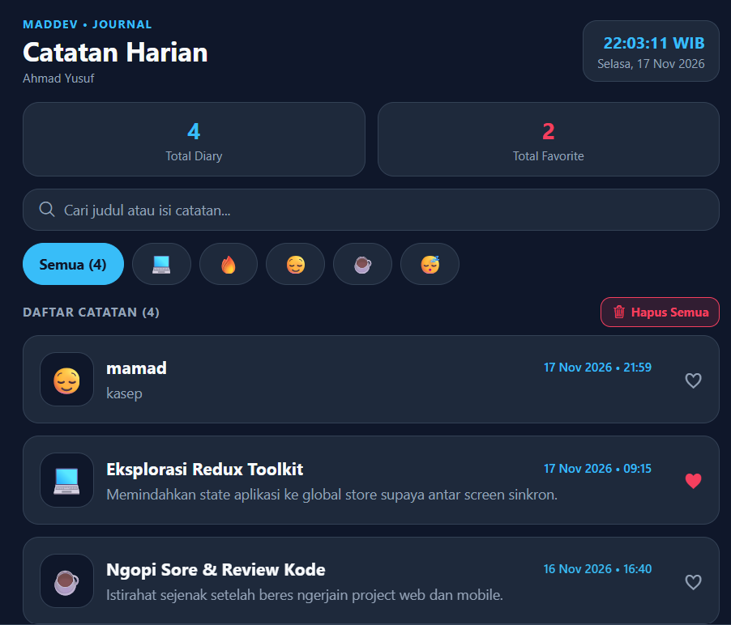
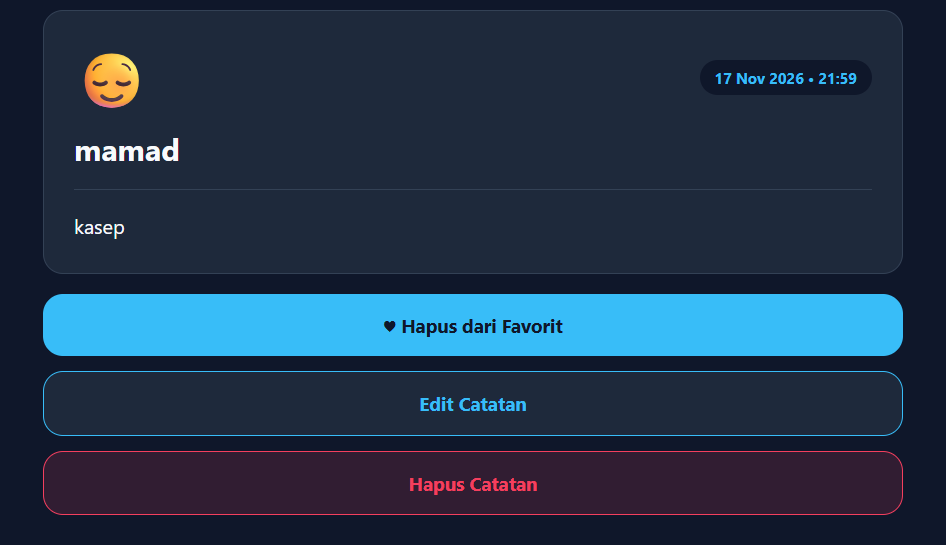
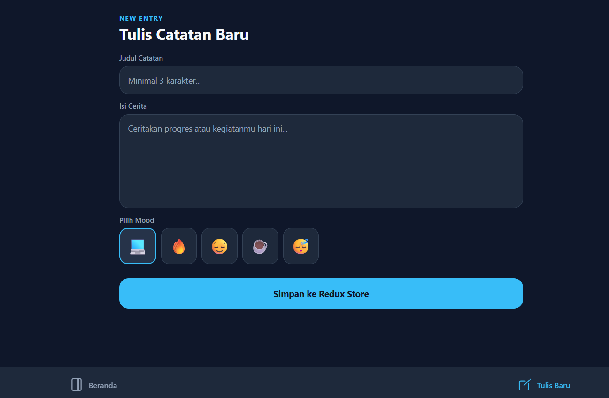
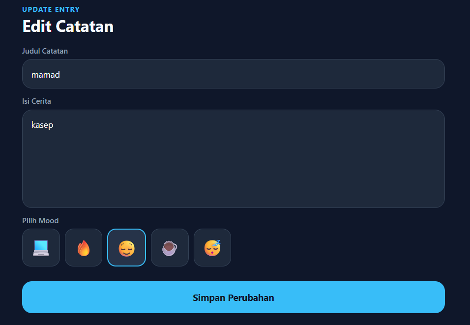

<div align="center">

# 📓 MADDEV • JOURNAL (`diary-app8`)

**Aplikasi Catatan Harian Modern Berbasis React Native, Expo Router & Redux Toolkit**


*Praktikum Mobile Programming — Pertemuan 8 • Program Studi Teknik Informatika*  
*Universitas Muhammadiyah Sukabumi*

</div>

---

## ✨ Tentang Aplikasi

**MADDEV Journal** adalah aplikasi pencatatan aktivitas harian dengan manajemen *global state* terpusat menggunakan **Redux Toolkit** dan **React-Redux**. Dirancang dengan antarmuka **Dark Slate & Sky Blue** yang responsif, aplikasi ini tampil proporsional baik saat dijalankan di browser desktop/laptop maupun perangkat mobile melalui Expo Go.

---

## 🚀 Fitur Utama

- **Manajemen Catatan (CRUD Lengkap):** Tambah catatan baru (`addDiary`), perbarui isi catatan (`editDiary`), hapus satuan (`deleteDiary`), hingga bersihkan seluruh catatan (`deleteAllDiaries`).
- **Sistem Favorit Sinkron:** Tandai catatan favorit (`toggleFavorite`) dan kelola daftar favorit (`clearAllFavorites`) yang otomatis tersinkronisasi lintas halaman.
- **Pencarian & Filter Mood Real-Time:** Kombinasi *search bar* untuk mencari judul/isi catatan serta filter cepat berdasarkan kategori mood (`💻`, `🔥`, `😌`, `☕`, `😴`).
- **Live Clock & Statistik:** Widget jam digital dan tanggal *real-time* di header beserta penghitung otomatis **Total Diary** dan **Total Favorite**.
- **Validasi Input & Empty State:** Proteksi form dengan validasi judul minimal 3 karakter serta tampilan *empty state* informatif ketika data kosong atau tidak ditemukan.

---

## 📸 Preview Tampilan Aplikasi

| Halaman Beranda & Statistik | Filter Mood & Pencarian |
| :---: | :---: |
|  |  |
| *Tampilan utama dengan jam real-time, statistik, dan daftar catatan.* | *Penyaringan catatan berdasarkan mood dan kata kunci pencarian.* |

| Tambah Catatan & Validasi | Detail & Edit Catatan |
| :---: | :---: |
|  |  |
| *Form pembuatan diary baru dengan pemilih mood dan validasi input.* | *Pembaruan judul, isi cerita, dan mood langsung ke Redux Store.* |

---

## 🧠 Konsep Arsitektur State

Sebagai bagian dari kajian **Modul Praktikum 08**, berikut perbedaan peran antara *local state*, *global Redux state*, dan *persistent database* di dalam arsitektur aplikasi ini[cite: 37]:

| Aspek | Local State (`useState`) | Global Redux State (Redux Toolkit) | Persistent Database (MySQL / REST API) |
| :--- | :--- | :--- | :--- |
| **Cakupan Akses** | Terbatas pada satu komponen atau screen tempat state dideklarasikan[cite: 3]. | Terpusat (*single source of truth*) dan dapat diakses dari seluruh screen secara sinkron[cite: 3]. | Tersimpan di server eksternal dan dapat diakses lintas sesi maupun perangkat[cite: 36]. |
| **Siklus Hidup Data** | Hilang saat komponen *unmount* atau pengguna berpindah halaman. | Tersimpan di memori (RAM) aplikasi; kembali ke `initialState` saat aplikasi di-*reload*/*restart*[cite: 35, 36]. | Permanen; data tetap tersimpan meskipun aplikasi ditutup atau perangkat dimatikan[cite: 35, 36]. |
| **Implementasi di App** | Input teks sementara pada form `Create` dan `Edit` (`title`, `body`, `mood`) serta kata kunci `searchQuery`[cite: 25]. | Daftar `entries`, status `liked`, `moodFilter`, serta statistik jumlah catatan lintas halaman[cite: 3, 28, 34]. | Penyimpanan akun dan riwayat catatan jangka panjang pada tahap integrasi backend[cite: 36, 38]. |

---

## 📂 Struktur Project

```text
diary-app8/
├── app/
│   ├── _layout.tsx            # Root Stack & Redux Provider
│   ├── (tabs)/
│   │   ├── _layout.tsx        # Konfigurasi Bottom Tab Navigation
│   │   ├── index.tsx          # Beranda, Live Clock, Statistik, Search & Filter
│   │   ├── create.tsx         # Form Tambah Catatan + Validasi
│   │   └── favorites.tsx      # Daftar Catatan Favorit + Clear All
│   ├── detail/[id].tsx        # Tampilan Detail Catatan
│   └── edit/[id].tsx          # Form Pembaruan Catatan
├── src/
│   ├── app/
│   │   ├── store.ts           # Konfigurasi Redux Store
│   │   └── hooks.ts           # Typed Hooks (useAppDispatch & useAppSelector)
│   ├── components/
│   │   └── DiaryCard.tsx      # Komponen Kartu Catatan Reusable
│   ├── features/diary/
│   │   └── diarySlice.ts      # State, Reducers & Actions Diary
│   └── styles/
│       └── tokens.ts          # Design Tokens (Colors, Spacing, Typography)
└── screenshots/               # Dokumentasi Tampilan UI
